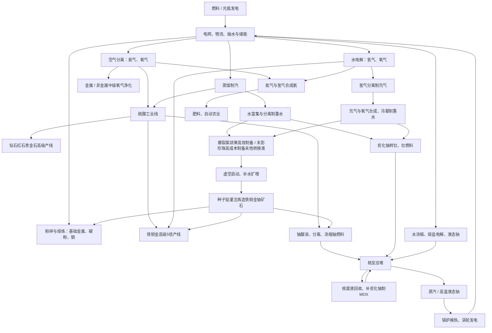

# 当前科技线总览

核对日期：2026-10-20。以 `src/main/resources/data/alone_mechanical/recipes/` 和当前运行代码为准，只列已经实现的路线。世界配置、其他模组及数据包可改变游戏内结果。

当前共有 **213条正式配方：129条机器加工、7条熔炉、7条高炉、70条工作台配方**。电弧炉还动态读取当前世界熔炼配方；发电、抽液、范围作业及涡轮运行由代码实现，不计入129条机器配方。逐条输入、输出和基础参数见[配方清单](technology-recipes.md)。

## 科技主干

机器制造已形成五阶段材料路线：**手工起步 → 钢与机械 → 电解液工业 → 高级能源 → 末地工业**。板材、导线、齿轮、电路与分级电池构成实际制造前置，进度页展示阶段，材料进入背包后解锁配方书。以下箭头表示实际原料依赖；创造储罐和快速搭建不作为生存原料来源。详细设备门槛见[机器制造与电池](machine-manufacturing.md)。



## 1. 起步：供电、物流、基础加工

| 内容 | 已实现流程 | 作用 |
| --- | --- | --- |
| 供电 | 燃料发电、太阳能、月光发电 → 电网核心、信号杆、供电桩 → 机器 | 默认燃料40 FE/t、太阳能320 FE/t、月光240 FE/t；月光机见天空时昼夜均可工作 |
| 储能 | 独立储能矩阵，充电 / 放电 / 动态平衡 | 平衡发电和加工负载 |
| 物流 | 物品、流体、气体各五级管道；物品仓、通用储罐、电动泵 | 储罐按输入介质选择液体或气体，每列只存一种 |
| 基础金属 | 粗铁 / 粗铜 / 粗金1 → 粉碎 → 对应粉2 → 熔炼 → 锭2 | 每粗矿2倍路线 |
| 碳材料 | 煤炭或木炭1 → 粉碎 → 碳粉1 | 钢的现有原料 |
| 钢 | 铁粉2 + 碳粉1 → 合金机 → 钢锭2 | 合金机的基础配方，也是后续殷钢路线前置 |
| 电弧炉 | 动态兼容当前世界熔炉熔炼配方 | 用FE替代熔炉燃料，沿用配方时间 |

电池是燃料发电机的一次性燃料。应急电池：马铃薯1＋红石1＋铜锭1，无序合成2个；可用背包或工作台。每个应急电池以煤炭1.5倍功率发电，燃烧时间与煤炭相同。初、中、高级空壳分别灌注对应电解液250、500、1000 mB，制成分级电池；高功率 / 长续航变体必须以成品高级电池为输入，再灌注250 mB改性液 / 稳定液。初级电解液来自硫与水，中级增加硫酸，高级再吸收氨气，详见[电池生产](machine-manufacturing.md)。

## 2. 基础化工：氧、氢、氮和蒸汽

| 工序 | 机器 | 单份输入 → 输出 | 基础时间 / FE |
| --- | --- | --- | --- |
| 空气分离 | 开口分离塔 | 环境空气 → 氮气400 mB + 氧气100 mB | 100 tick、20 FE/t |
| 水电解 | 三相分离器 | 水1000 mB → 氢气1000 mB + 氧气500 mB | 200 tick、60 FE/t |
| 制汽 | 蒸馏塔 | 水1000 mB → 蒸汽1000 mB | 100 tick、20 FE/t |
| 冷凝 | 冷凝塔 | 蒸汽1000 mB → 水1000 mB | 100 tick、20 FE/t |

氧气接矿物净化、硫酸和重水合成；氢气接金属晶体还原、氘气提取和合成氨；氮气接合成氨；蒸汽接硫酸水合、涡轮发电与水回收。

空气分离塔需在GUI开启并供电。塔滑块既改变批次预算，也增加每份耗电：额外倍率为 `1 + 强度百分比/100`，100%为2倍，然后叠加线圈、实际批量。分离塔默认每m³提供100 mB批次预算，储存容量仍每m³为1000 mB。

## 3. 硫酸：高级矿业与核燃料的交汇点

| 顺序 | 输入 → 输出 | 机器模式 |
| --- | --- | --- |
| 1 | 煤炭或木炭1 + 水1000 mB → 硫1 | 反应釜·溶解析晶 |
| 2 | 硫1 + 氧气1000 mB → 二氧化硫1000 mB | 反应釜·固转气化 |
| 3 | 二氧化硫1000 mB + 氧气500 mB → 三氧化硫1000 mB | 反应釜·气相化合 |
| 4 | 三氧化硫1000 mB + 蒸汽1000 mB → 硫酸气体1000 mB | 反应釜·气相化合 |
| 5 | 硫酸气体1000 mB → 液态硫酸1000 mB | 气液转换机·液化 |

用途：铁铜金5倍加工、钻石红石青金石高级酸浸、铀粉酸溶。首段只产硫；当前没有无烟煤副产物，也没有发烟硫酸分支。详见[硫酸产线](sulfuric-acid-line.md)。

## 4. 矿物加工：氧气升级，硫酸再升级

### 铁、铜、金

| 档位 | 流程 | 每粗矿最终产量 | 关键补给 |
| --- | --- | --- | --- |
| 初级 | 粗矿 → 粉碎 → 熔炼 | 2锭 | FE |
| 中级 | 粗矿 → 氧气灌注净化 → 3矿团 → 共用粉碎 → 熔炼 | 3锭 | 氧气200 mB |
| 高级 | 粗矿 → 硫酸溶解 → 水洗矿浆 → 分离5晶体 → 氢还原5矿团 → 共用粉碎 → 熔炼 | 5锭 | 回收后净耗硫酸500 mB、水500 mB、氢气1000 mB |

高级分离产生酸性母液；母液1000 mB可分回硫酸500 mB与水500 mB。倍率从粗矿开始计算，矿团 / 晶体 / 粉不能重复进入首段倍产。详见[金属加工](ore-processing-design.md)。

### 钻石、红石、青金石

三者入口均为普通或深层**矿石方块**。初级直接粉碎；中级氧气灌注成矿团再粉碎；高级硫酸灌注成碎片、水洗成矿团再粉碎。

| 每块矿石 | 初级 | 中级 | 高级 |
| --- | ---: | ---: | ---: |
| 钻石 | 2 | 3 | 5 |
| 红石 | 10 | 15 | 25 |
| 青金石 | 18 | 27 | 45 |

中级耗氧气200 mB；高级耗硫酸500 mB、水1000 mB，不产生母液。当前三种非金属高级线均使用灌注机和粉碎机，不使用塑形机。详见[非金属加工](nonmetal-processing.md)。

## 5. 重水：两条路线，同一后续

| 路线 | 工序 | 产出及回收 |
| --- | --- | --- |
| 水富集 | 蒸馏塔：水1000 → 蒸汽950 + 富集水50；分离器：富集水1000 → 水900 + 重水100 | 蒸汽可冷凝回水，分离水可回流；富集需输出2端口 |
| 氘合成 | 分离器：氢气1000 → 氢气990 + 氘气10；反应釜：氘气1000 + 氧气500 → 重水蒸汽1000；冷凝塔 → 重水1000 | 氢气990可回流并补新氢；合成需累计1000 mB氘气 |

表中流体和气体数量均为mB。重水用于贫化铀转钍，以及末地转换液；目前没有重水电解取氘配方，取氘来源是氢气分离。详见[重水生产与回收](heavy-water.md)。

## 6. 核燃料、液态钠与核热发电

### 核燃料准备与回收

| 分支 | 已实现流程 |
| --- | --- |
| 铀原料 | 主世界自然生成铀矿 / 深层铀矿 → 铁镐及以上采掘得到粗铀；粗铀1 → 粉碎 → 铀粉2；粗铀 / 铀粉也可1:1熔炼成铀锭 |
| 浓缩铀燃料 | 铀粉4 + 硫酸1000 mB → 铀矿浆1000 mB → 浓缩铀化合物1 + 贫化铀粉3；化合物1 + 水1000 mB → 浓缩铀燃料1000 mB |
| 钍燃料 | 贫化铀粉4 + 重水100 mB → 钍粉4；钍粉4 + 水1000 mB → 钍燃料1000 mB |
| MOX回收 | 核废液1000 mB → 回收燃料颗粒1 + 封装核废物9；颗粒1 + 贫化铀粉3 → 混合燃料化合物1；再加水1000 mB → MOX燃料1000 mB |

钍粉来源是当前游戏配方，非独立钍矿。MOX需持续补贫化铀；封装核废物目前是终端产物。核反应堆消耗液态燃料，燃料棒方块是结构件。详见[燃料与农业](fuel-and-agriculture.md)。

初始铀矿生成于主世界Y=-64～64，Y=0附近最集中；每区块尝试8个矿脉，矿脉尺寸8。常规丰度定位低于铁、高于普通群系的金，保留恶地额外金矿。旧存档需探索新生成区块。详见[铀矿自然生成](uranium-worldgen.md)。

### 液态钠准备与回流

```text
水1000 → 分离 → 回收水900 + 卤水100
卤水1000 → 蒸馏 → 熔融氯化钠200 + 蒸汽800
熔盐1000 → 分离电解 → 液态钠500 + 氯气500
```

氯气可保存或排放，当前尚无消耗配方。液态钠和高温液态钠沿用 `heat_carrier` / `superheated_heat_carrier` ID。

### 从燃料到FE

| 路径 | 已实现转换 |
| --- | --- |
| 水冷核热 | 燃料1 mB + 水50 mB → 核废液1 mB + 蒸汽50 mB → 涡轮发电 |
| 钠冷核热 | 燃料1 mB + 液态钠50 mB → 核废液1 mB + 高温钠50 mB |
| 钠换热 | 锅炉：水50 mB + 高温钠1 mB → 蒸汽50 mB + 液态钠1 mB；液态钠回堆 |
| 换热替代 | 交换塔同配比换热；基础20 FE/t，再计塔强度与实际批量；锅炉配方基础0 FE/t |
| 涡轮 | 每转子消耗蒸汽50 mB/t，产生250 FE/t；转子必须和能量矩阵同高同一水平轴连接 |

三种燃料各支持水冷 / 钠冷，共6条核配方。相同配方mB比例不表示三种燃料的事故等级相同。钠冷的实际50倍制汽增益来自当前锅炉参数：50 mB高温钠可分50份换热，合计2500 mB蒸汽。

核堆已实现温度、停堆、余热冷却、分燃料爆炸和辐射。缺料、停止燃烧不等于余热消失；这是一条需持续冷却和清空废料的热工线。涡轮当前消耗蒸汽后不产乏汽或凝结水，不能画成已经闭合的水循环。详见[核热、事故与钠产线](reactor-safety-and-void-ores.md)。

## 7. 农业支线

```text
氮气1000 mB + 氢气3000 mB → 氨气2000 mB
骨粉1 + 氨气500 mB → 肥料4
肥料 → 手动作物增熟 / 收割塔施肥与收获
繁殖食物 → 养殖塔 → 动物数量增长
动物超出逐种保留数量 → 屠宰器 → 掉落物
```

肥料和收获可共用收割塔，施肥需要可选输入仓；无肥料仍可普通收割。养殖、屠宰有独立生物配置与数量限制；驱逐塔抑制范围内敌对生物刷新。这些世界行为不需要机器JSON配方。

农业已经接入化工消耗，但尚无生物质 / 乙醇 / 沼气或树脂生产线。

## 8. 维度材料与虚空再造

| 阶段 | 已实现流程 | 下游 |
| --- | --- | --- |
| 地狱转换液 | 烈焰粉1 + 岩浆1000 mB → 1000 mB；主世界替代：黑曜石8 + 岩浆1000 mB → 250 mB | 每次灌注消耗250 mB，制黑石、玄武岩、灵魂沙、石英、荧石、地狱疣、菌类 / 藤蔓等 |
| 水转岩浆 | 水1000 mB + 地狱转换液250 mB → 岩浆1000 mB | 持续消耗转换液，不是单靠水无代价生岩浆 |
| 末地转换液 | 爆裂紫颂果1 + 重水1000 mB → 1000 mB；主世界替代：末影珍珠4 + 重水1000 mB → 250 mB | 每次灌注消耗250 mB，制末地石、紫颂花、紫颂果、龙息 |
| 虚空启动 | 水1000 mB + 末地转换液250 mB → 液态虚空1000 mB | 获得首批启动液 |
| 虚空扩增 | 液态虚空250 mB + 水1000 mB → 液态虚空1000 mB | 每批净产750 mB；未升级64000 FE，需留250 mB回流 |
| 虚空再造 | 铁 / 铜 / 金 / 铀锭1 + 虚空1000 mB → 对应矿石1 | 灌注机，200 tick、240 FE/t；将矿石放置采掘后接矿业线 |

共有14条维度物品灌注、7条转换液与虚空液相配方、4条矿石再造。部分菌类和藤蔓产物是二选一，不是一次得到两种。

虚空有了实际消耗端；再造消耗种子锭，不返还。铁铜金再造输出是矿石方块，粗矿加工线不能直接吃矿石，要先采掘。铀再造也需要首个铀锭，初始铀来自主世界自然生成的铀矿。详见[维度与虚空](dimension-fluid-production.md)。

## 9. 机器分工与现有覆盖

| 设备 | 当前定位 |
| --- | --- |
| 粉碎机、熔炉 / 高炉、电弧炉 | 初级倍产与共用后处理；电弧炉动态读熔炼配方 |
| 灌注机 | 氧气净化、非金属高级线、维度物品、虚空矿石再造，30条正式配方 |
| 双相反应釜 | 制酸、矿浆洗选、还原、燃料调配、氨合成、维度液体等；9种介质模式已支持，并非每种都有自带配方 |
| 三相分离器 | 水电解、析晶回酸、重水、铀 / 废液、卤水及熔盐；18种介质模式已支持，并非每种都有自带配方 |
| 气液转换机 | 当前正式默认仅硫酸气体液化；蒸汽冷凝由冷凝塔负责 |
| 蒸馏塔 / 冷凝塔 / 交换塔 / 分离塔 | 分别承担蒸馏富集、冷凝、上下独立空间换热、环境空气分离 |
| 合金机 | 炼钢，以及赤铜、殷钢、共振、超导、量子五级中间料；成品继续经过烧结、锻压、氧气活化、重水稳定或液态钠淬定 |
| 锻压机、塑形机 | 机器接口、结构与加工逻辑已有，正式配方为0条 |
| 范围机器与涡轮 | 代码驱动，不以“无JSON配方”判断为未实现 |

所有普通加工多方块共用工业核心，正上方组件选机型；核堆由同高紧邻燃料棒识别。反应釜和分离器由独立仓储通道介质选择模式。各气体输出可分别保存、仅排多余、全部排出；需要回流的氢气或蒸汽应保留，液体 / 物品出口仍需有容量。

## 10. 当前断点与平衡问题

以下是本次源码核对结果，不是本次要自动新增的内容。

| 项目 | 当前状态 | 对科技线的影响 |
| --- | --- | --- |
| 下界合金粉 | 仍缺正式加工与用途链 | 当前末地阶段制造直接使用下界合金锭，粉末不充当材料门槛 |
| 终端副产物 | 氯气、封装核废物尚无下游加工 | 氯气可排放，封装废物需储存；不应标成完整物质闭环 |
| 电制汽收益 | 默认1000 mB蒸汽可发5000 FE；普通蒸馏制汽基础2000 FE，100%塔强度也只4000 FE，未计其他费用 | 现有电制汽→涡轮可净增FE，线圈还会减小制汽成本 |
| 钠换热增益 | 核堆将50 mB钠加热；锅炉1 mB热钠即可制50 mB蒸汽 | 钠冷与水冷同燃料下发电量相差较大，需作为显式平衡参数审议 |
| 能量线圈 | 加法减耗且没有额外数量上限，非热工加工每份最低1 FE/t | 高耗能配方不等于严格阶段门槛 |

此前“机器没有制造配方”“分级电池无法生产”“钢粉旁路未接通”“初始铀缺自然来源”“液态钠缺制作入口”“虚空没有下游用途”“灌注机无默认配方”已经不适用于当前版本。石英砂和钻石粉也已接入制造线。

## 阅读与建设顺序

便于测试现有内容的顺序为：**供电物流 → 基础粉碎 / 钢 → 空气分离与电解 → 硫酸 → 矿物升级 → 重水 → 铀燃料及钠冷却 → 核热与涡轮 → 末地转换液 / 虚空再造**。农业化工和地狱转换液可在相应原料具备后并行开展，不必等核能完成。

原料依赖不要求“必须先核能才能启动虚空”；当前只需具备重水、末影珍珠、供水及足够FE即可走高成本主世界路线，进入末地取得爆裂紫颂果后可改用高效路线。
