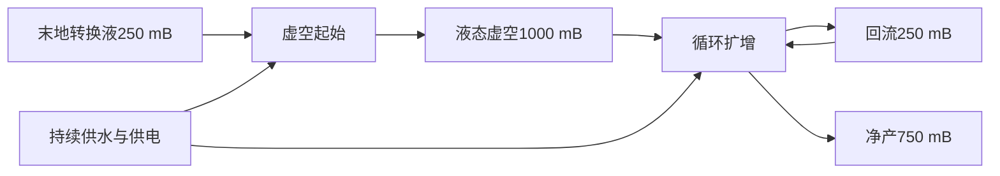

# 维度转换液与液态虚空

2026-10-18新增消耗用途：[一锭＋1000 mB虚空再造对应铁、铜、金、铀矿石](reactor-safety-and-void-ores.md)，使用灌注机。

新增一种Forge流体：`alone_mechanical:liquid_void`（液态虚空，深紫色动态水材质），无专用桶。可用流体管、普通储罐及500 mB取液枪运输；创造栏杂项中的创造储罐自动覆盖。

| 配方 | 机器模式 | 输入1 | 输入2 | 输出1 | 时间 | 基础耗能 |
|---|---|---|---|---|---|---|
| 地狱转换液高效制备 | 固液溶解 | 烈焰粉1 | 岩浆1000 mB | 地狱转换液1000 mB | 200 tick | 80 FE/t |
| 地狱转换液主世界替代 | 固液溶解 | 黑曜石8 | 岩浆1000 mB | 地狱转换液250 mB | 400 tick | 240 FE/t |
| 末地转换液高效制备 | 固液溶解 | 爆裂紫颂果1 | 重水1000 mB | 末地转换液1000 mB | 240 tick | 120 FE/t |
| 末地转换液主世界替代 | 固液溶解 | 末影珍珠4 | 重水1000 mB | 末地转换液250 mB | 400 tick | 240 FE/t |
| 水转岩浆 | 液相混合 | 水1000 mB | 地狱转换液250 mB | 岩浆1000 mB | 100 tick | 80 FE/t |
| 虚空起始 | 液相混合 | 水1000 mB | 末地转换液250 mB | 液态虚空1000 mB | 200 tick | 160 FE/t |
| 虚空循环扩增 | 液相混合 | 液态虚空250 mB | 水1000 mB | 液态虚空1000 mB | 200 tick | 320 FE/t |

每个反应釜使用工业核心＋正上方化合组件。固液溶解为物品输入、液体输入、液体输出三列；液相混合为三列独立液体仓储。物品/液体混合输入沿用既有互换规则；两路同为液体时必须严格按表中输入1/2接线。

## 循环收支

一次末地原生高效制备可启动四批虚空起始；主世界替代配方每批只够启动一次。按1000 mB计算，地狱替代路线消耗32黑曜石、4000 mB岩浆、384,000 FE；末地替代路线消耗16末影珍珠、4000 mB重水、384,000 FE。取得首批虚空后，扩增不再需要末影珍珠、重水或末地转换液。

每批扩增消耗250 mB虚空、1000 mB水、64,000 FE，输出1000 mB虚空。回流250 mB后，净产750 mB。连续三批净产2250 mB，保留250 mB启动储备，累计消耗3000 mB水与192,000 FE。上述能耗不含启动阶段，按未安装升级块计算。

输出1通过流体管回接输入1；保持至少250 mB启动储备，再分出多余产品。简单布局可先关闭产品出口、蓄满输入缓存后再开放产品支路。回流和外送受既有管道分流及限速规则影响。水为持续补给，FE为持续消耗；这是启动液自循环，并非无需外部供给的封闭系统。

空罐或不足250 mB启动液不能直接扩增。缺水、低电量、输出满或介质不匹配时暂停，按原有机器整批提交机制保留原料。支持线圈、处理矩阵、存档进度与介质恢复。

原有14个物品灌注配方保留，仍消耗每份250 mB对应维度转换液。教程章节“维度转换液与虚空循环”和JEI对应分类会展示全部七条转换液及虚空配方。

资源生成：`tools/generate_dimension_fluid_resources.ps1`，已接入完整及帮助资源更新。测试入口：`tools/dimension-fluid-tests.gradle`，覆盖制造、循环收支、管道回流、取液枪、创造储罐、堵塞、缺电、缺启动液、存档和配方同步，并运行相关既有维度灌注、重水及创造储罐测试。
