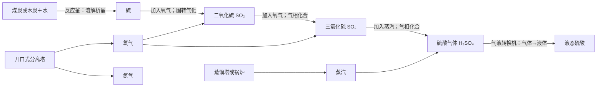

# 硫酸工业产线

本线按最后确认的流程，仅从煤炭/木炭提取硫，不产出无烟煤：



| 配方 | 机器模式 | 输入1 | 输入2 | 输出1 | 时长 | 基础耗能 |
| --- | --- | --- | --- | --- | --- | --- |
| 湿法制硫 | 反应釜·溶解析晶 | 煤炭或木炭1个 | 水1000 mB | 硫1个 | 200 tick | 40 FE/t |
| 硫氧化 | 反应釜·固转气化 | 硫1个 | 氧气1000 mB | SO₂ 1000 mB | 100 tick | 40 FE/t |
| 接触氧化 | 反应釜·气相化合 | SO₂ 1000 mB | 氧气500 mB | SO₃ 1000 mB | 160 tick | 60 FE/t |
| 蒸汽水合 | 反应釜·气相化合 | SO₃ 1000 mB | 蒸汽1000 mB | 硫酸气体1000 mB | 120 tick | 60 FE/t |
| 硫酸液化 | 气液转换机·气体→液体 | 硫酸气体1000 mB | 无 | 液态硫酸1000 mB | 100 tick | 40 FE/t |

每台反应釜使用工业核心＋正上方化合组件，三个独立仓储列分别接输入1、输入2、输出1。物品列用物品仓，液体/气体列可使用统一储罐，通用端口紧贴列的上端或下端。不同介质的两路输入可交换；同为气体时必须按配方表指定通道进料。

气液转换机使用工业核心＋气液转换组件，只需要气体输入1、液体输出1两列储罐，GUI选择“气体→液体”。本线只提供硫酸液化，不额外注册反向气化配方。

气体管道运输氧气、蒸汽、SO₂、SO₃和硫酸气体；流体管道运输水与液态硫酸。硫接受 `forge:dusts/sulfur` 标签。液态硫酸是真实 Forge 流体，支持统一储罐和取样工具；气态硫酸是独立气体，不能当液体直接灌入液态通道。缺料、缺电、输出堵塞时暂停；线圈及处理矩阵沿用原有规则，存档恢复加工进度及介质。

原料与气体注册 ID：

| 资源 | ID |
| --- | --- |
| 硫物品 | `alone_mechanical:sulfur` |
| 氧气 | `alone_mechanical:oxygen` |
| 氮气 | `alone_mechanical:nitrogen` |
| 二氧化硫 | `alone_mechanical:sulfur_dioxide` |
| 三氧化硫 | `alone_mechanical:sulfur_trioxide` |
| 蒸汽 | `alone_mechanical:steam` |
| 硫酸气体 | `alone_mechanical:sulfuric_acid`（气体接口） |
| 液态硫酸 | `alone_mechanical:sulfuric_acid`（Forge 流体接口） |

气体与液体属于两个独立接口空间，同名 ID 不会混存。

## 分离塔供应氧气

工业核心正上方紧贴空气分离组件；最小5×5×7，顶面中央完全留空，只保留外壳边框。底面及边框使用机器外壳或强化外壳，侧壁完整，配置唯一控制器和至少一个能量矩阵。只需要输出1氮气、输出2氧气两个通用端口，无需输入或附加储罐。

成型后默认关闭。右键 GUI 开启，供电后自动从环境空气分离气体。每份400 mB氮气＋100 mB氧气，20 tick，20 FE/t；按容积滑块决定批次数，耗能随实际批量增加，任一产物没有空间时整批暂停。开关、进度和气体可随存档恢复。可使用：

```text
/AloneMechanical build +air_separation_tower
```

氧气也可由原有分离机电解水获取。蒸汽可来自蒸馏塔的水蒸馏配方，或原有锅炉。

## 蒸汽渲染

保留原版/资源包的动态水图集，GUI、JEI及储罐渲染采用中性水纹理着色。气体不再重复叠乘水素材自身的半透明度，蒸汽按白色、约72%不透明度显示；硫气体使用轻微区分色。液态硫酸保留原有液体渲染与独立浅黄透明色。

## 工艺抽象

后段“SO₃＋水蒸气生成硫酸气体，再冷凝为液体”参考湿法硫酸工艺；[Topsoe 的 WSA 说明](https://www.topsoe.com/solutions/technologies/process-licensing/wet-gas-sulfuric-acid-wsa-technology)描述了这一过程。煤/木炭＋水取硫、物料 mB、FE、时长和无需单独催化剂均为本模组玩法设定，不表示真实煤炭或木炭能按此配方转化。
