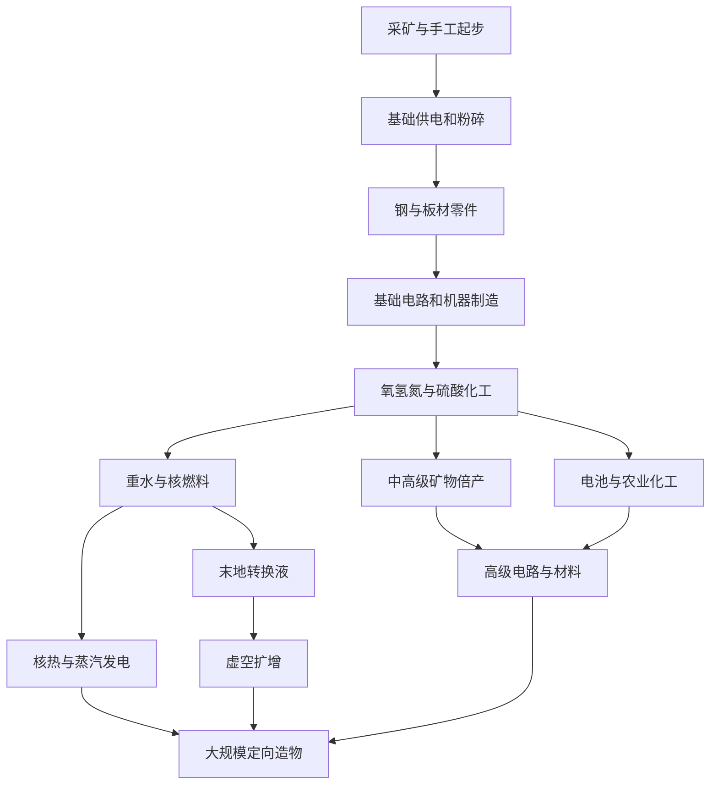

# 科技线盘点与扩展建议

> 历史盘点（2026-10-17）。当前科技线请阅读[2026-10-20科技线总览](current-technology-tree.md)及[正式配方清单](technology-recipes.md)。本文保留旧建议，不作为当前实现状态；液态钠、核事故与虚空再造已实现。

整理日期：2026-10-17。依据当前正式配方 JSON、物品/流体注册、机器运行代码；不把测试配方、创造储罐和管理员搭建命令计入生存获取方式。这里只整理设计，不修改玩法或恢复之前移除的配方。

后续更新：2026-10-18已实现本报告中载热剂制作、核事故/辐射，以及“锭＋虚空再造矿石”方向，见[实现说明](reactor-safety-and-void-ores.md)。下方配方统计与“待开发”描述保留盘点当天状态。

## 当前状态

正式资源包含 104 条配方：91 条机器配方、5 条熔炉配方、5 条高炉配方、3 条工作台配方。电弧炉另读取世界中已加载的熔炼配方，不包含在这 91 条机器配方中。数据包可改变实际游戏内容。

目前已经有多条加工路线，但机器制造与阶段解锁尚未形成完整的生存科技树。机器方块工作台配方由 `tools/remove_machine_block_recipes.ps1` 按现有设计移除，不应把它当成意外遗漏后直接恢复。

## 已实现产线

| 产线 | 现有流程 | 当前作用 |
| --- | --- | --- |
| 基础供电与物流 | 燃料/太阳能/月光发电 → 电网 → 供电桩 → 机器；储能矩阵调节充放电 | 自动化基础，物品/流体/气体各有五级管道 |
| 钢与基础金属 | 粗铁/铜/金 → 粉碎 → 2粉 → 熔炼；2铁粉＋1碳粉 → 合金冶炼 → 2钢锭 | 金属基础产出；合金机当前只有钢配方 |
| 金属高级倍产 | 氧气净化 → 矿团 → 粉碎 → 3锭；硫酸酸溶 → 水洗矿浆 → 析晶 → 氢还原 → 共用粉碎尾段 → 5锭 | 铁、铜、金2/3/5倍；高级线回收部分酸和水 |
| 非金属倍产 | 钻石/红石/青金石矿石直接粉碎；氧气净化；硫酸破晶＋水洗 | 三档固定产量：钻石2/3/5，红石10/15/25，青金石18/27/45 |
| 空气与水处理 | 空气分离 → 氮/氧；水电解 → 氢/氧；蒸馏、冷凝 | 化工基础介质与蒸汽供应 |
| 硫酸化工 | 煤/木炭＋水 → 硫 → SO₂ → SO₃ → 硫酸气体 → 液态硫酸 | 金属/非金属高级倍产、铀酸溶 |
| 重水 | 水蒸馏 → 富集水 → 重水；或氢分离 → 氘＋氧 → 重水蒸汽 → 冷凝 | 钍材料与末地转换液的前置 |
| 核燃料 | 粗铀 → 铀粉 → 酸溶矿浆 → 浓缩铀化合物＋贫化铀粉 → 调配燃料 | 浓缩铀、MOX、钍液态燃料均可制备 |
| 核燃料分支 | 贫化铀粉＋重水 → 钍粉 → 钍燃料；核废液 → 回收颗粒＋封装废物，颗粒＋贫化铀 → MOX | 回收需要补料，封装废物目前是终端产物 |
| 核热能 | 液态燃料＋水 → 蒸汽＋核废液；或燃料＋载热剂 → 过热载热剂，供锅炉/交换塔制汽 → 涡轮发电 | 水冷路径已有加工配方；载热剂路径缺制作入口 |
| 农业化工 | 氮＋氢 → 氨；氨＋骨粉 → 肥料 → 收割塔施肥/收割 | 养殖塔、屠宰器可提供农业与骨粉来源；驱逐塔提供区域控制 |
| 维度转换 | 烈焰粉＋岩浆高效制地狱转换液，黑曜石提供昂贵主世界替代；爆裂紫颂果＋重水高效制末地转换液，末影珍珠提供昂贵主世界替代 | 共14条灌注配方；地狱转换液还能与水制岩浆 |
| 液态虚空 | 水＋末地转换液启动；250 mB虚空＋1000 mB水 → 1000 mB虚空 | 每批净产750 mB，需要持续供水和电，尚无下游消耗配方 |

核反应堆实际消耗液态燃料，反应堆燃料棒方块是结构件。设计后续配方时，应沿用这一系统，避免误写成投放消耗型燃料棒。

## 当前空缺与需要核对的收支

1. **制造层缺失。** 锻压机、塑形机没有正式机器配方。钢锭、矿物倍产和化工产品缺少通往机器组件、升级件和管道等级的统一制造链。
2. **钢粉路线未接通。** 已有“铁粉＋煤炭粉 → 钢粉”工作台配方，但煤/木炭粉碎实际产碳粉，当前正式配方没有煤炭粉来源，也没有钢粉转钢锭的配方。合金机的铁粉＋碳粉炼钢路线不受此影响。
3. **已注册材料缺用途。** 石英砂、钻石粉、下界合金粉目前没有正式加工入口或下游配方，可在新材料线中使用，也可暂时隐藏，避免产生错误预期。
4. **电池制造缺失。** 各种电池仍能作为发电机消耗型燃料，但正式资源没有制造配方；应急电池原先讨论的配方也不在当前目录。可作为新产线设计点，不自动恢复旧配方。
5. **核能生存入口不完整。** 有铀矿方块、掉落及加工，但当前源码资源中未发现自然生成配置；载热剂也无制作配方。核燃料的“可加工”不代表已能从普通生存自然获取完整建设链。
6. **电制汽发电存在获利空间。** 默认涡轮50 mB蒸汽发250 FE，即1000 mB发5000 FE。普通蒸馏配方1000 mB水制1000 mB蒸汽，名义耗2000 FE，塔强度还增加实际费用；即使100%强度按2倍计算也为4000 FE，低于涡轮输出。线圈可进一步降低制汽费用。若要建立核能阶段，建议先决定这种“电＋水增殖电力”是否允许。
7. **蒸汽发电尚无凝结水回路。** 当前涡轮仅消耗蒸汽并发电，不产出乏汽或水，不能直接画成已实现的闭式水循环。
8. **升级会影响阶段平衡。** 能量线圈按加法减耗且数量不限，可把高基础耗能配方降到最低值。高级材料门槛不宜只依靠FE消耗，仍需专属原料或工序。

## 建议开发方向

以下全部是待开发设计，不是当前已有配方。编号可用于后续指定实现范围。

### 1. 工业零件与电路主线（优先）

利用现有锻压、塑形、灌注、合金设备，先让机器制造具有实际需求。

- 锻压：铁锭/铜锭/钢锭 → 对应金属板。
- 塑形：铜板 → 导线，钢板 → 齿轮或机械零件。
- 粉碎：石英 → 石英砂。
- 合金或反应：石英砂＋碳材料 → 粗硅；再净化为电子级硅，具体机型和介质需设计。
- 装配：硅、铜线、红石 → 基础电路；进阶电路增加化工或维度材料。
- 下游：外壳、工业核心、机型组件、端口、管道、线圈及矩阵使用对应零件。

首台基础粉碎机不能要求它自己才能生产的粉末或钢板；需要保留手工起步配方，或设计低效替代材料。五级管道可逐步使用金属板、电路和高级合金，不只增加钢锭数量。

### 2. 核热与蒸汽循环完善（优先）

- 增加载热剂调配入口，使用现有金属和水即可起步，具体配比作为游戏参数。
- 保留反应堆加热 → 锅炉/交换塔取热 → 冷载热剂回流的现有路径。
- 涡轮增加乏汽输出，冷凝塔回收水；这一步需要新增输出逻辑和界面，不是只加JSON。
- 重新核算电制汽、核制汽、蒸馏副产汽的收益，避免电制汽自循环压过燃料和核能。
- 补铀矿生成或明确替代来源，让核燃料路线能在生存中启动。

### 3. 合金与结构材料

先补齐钢粉路线，再扩展少量有明确用途的合金。

- 精炼钢/耐热钢：用于高级外壳、锅炉和涡轮零件，可复用现有铁、钢、碳、氧气体系。
- 若新增锡：铜＋锡 → 青铜，用于中期机械与管道。
- 若新增镍：铁＋镍 → 殷钢，用于热工与低温设备。
- 氧气或氢气参与部分合金精炼，使用合金机已有的物品＋气体支持。

建议第一批只做一种进阶合金并绑定数个实际用途，避免同时新增多种矿物但没有消耗需求。

### 4. 电池与储能材料

把硫酸、金属加工和农业接到电力基础设施上。

- 起步已实现：马铃薯1＋红石1＋铜锭1无序合成2个应急电池，承接农业与基础金属。
- 中期：金属电极＋碳材料＋硫酸 → 化工电池材料 → 现有分级消耗型电池。
- 高功率/长续航配方使用不同电极或结构材料，体现功能差异。
- 能量矩阵使用电池材料和电路制造，建立“加工能力提高 → 电网与储能扩容”的消耗关系。

当前电池是一次性发电燃料；若改成可充放电物品，需要另做能量接口、GUI和自动化支持，不能只改名字。

### 5. 生物质与有机化工

让自动收割/养殖产物除了食物外还能进入工业。

- 作物、种子、腐肉等 → 生物质；再制沼气或乙醇。
- 沼气/乙醇 → 专用燃料发电，或生物质 → 生物炭 → 碳材料。
- 酸处理＋有机原料 → 树脂/聚合物，供应电路绝缘和高级管道。
- 肥料继续服务收割塔，农业输出再供应燃料与材料。

可先只加生物炭与一种树脂，复用现有机器；液体/气体燃料发电需要新增设备或修改发电机接口。

### 6. 液态虚空与定向造物（后期主线）

在现有扩增回路后增加有实际消耗的产物链。

- 第一步：虚空＋廉价基底 → 粗物质/物质基底。
- 第二步：基底＋不同定向介质或材料 → 石材、沙、黏土等基础资源。
- 第三步：高阶定向核心＋更多虚空 → 铁、铜等矿物；贵重资源另加更高阶成本。
- 后期拓展：末地材料＋高级电路 → 更高效的造物组件，作为大规模化工与供电的共同目标。

先建立基础建材路线，再开放矿物。首批矿物产物建议直接给粉末/锭或专用低品位原料；如果直接给现有粗矿，会再乘上2/3/5倍加工收益，必须把整个链条一并核算。配方应持续消耗虚空，回流仅保留扩增启动量。

## 推荐阶段关系

下面是建议的生存阶段，不表示当前代码已经加入了解锁限制。

建议实施顺序：**1工业零件与电路 → 2核热及能源收支 → 6虚空造物**。3合金、4电池、5有机化工可以分别插入对应阶段。这样现有矿业、化工、农业和核能都有去向，最后由造物系统形成长期建设目标。

## 主要核对入口

- `src/main/resources/data/alone_mechanical/recipes/`：正式配方及输入输出。
- `src/main/java/Alone818/com/alone_mechanical/init/ModItems.java`、`ModBlocks.java`、`ModFluids.java`：已注册内容。
- `src/main/java/Alone818/com/alone_mechanical/blockentity/MachineBlockEntity.java`、`Config.java`：涡轮运行及默认能量参数。
- [矿物倍产](ore-processing-design.md)、[非金属倍产](nonmetal-processing.md)、[硫酸](sulfuric-acid-line.md)、[重水](heavy-water.md)、[核燃料与农业](fuel-and-agriculture.md)、[维度与虚空](dimension-fluid-production.md)。
